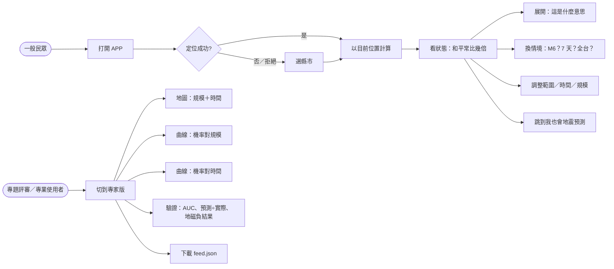

# 設計書（v0.1 雛型）

> 狀態：**雛型階段，全部是假資料**。使用者在手機上試用、回饋後，才接真資料、Actions、部署。

## 1. 目標與定位

把破專題的「連續式風險函數」做成一般人看得懂的手機網頁 APP（PWA）。

- **大眾版**：打開就看到「我附近現在和平常比怎樣」，一個狀態、一個數字，不需要懂模型。
- **專家版**：「規模、時間、地點三選二」的三種檢視、回測驗證、原理與資料下載。

**為什麼用倍數決定顏色、而不是絕對機率**：M5 以上 3 天內的機率在台灣幾乎永遠是「個位數 %」，
單看絕對值無法判斷高低，也容易讓人以為「很低＝安全」。倍數（現在÷平常）才是模型帶來的資訊；
絕對機率仍放在下方，兩者都看。

## 2. 頁面清單

| 路由 | 頁面 | 內容 | 一定要有／有空就做 |
|---|---|---|---|
| `#/` | 大眾首頁 | 位置、條件、一個狀態（倍數＋顏色）、現在／平常機率、資料新鮮度與低估幅度、三個摺疊區 | 一定要有 |
| 〃 摺疊 1 | 這個數字是什麼意思 | 不是預報、倍數的意義、資料限制 | 一定要有 |
| 〃 摺疊 2 | 情境卡片 | M6／7 天／M4／全台；ExpTech 模擬器連結（附標註） | 有空就做（雛型已放） |
| 〃 摺疊 3 | 更多 | 跳專家版各頁、跳「我也會地震預測」（`?q=` 帶入） | 一定要有 |
| 面板 | 選位置 | 使用目前位置、20 縣市（金門、連江在網格外） | 一定要有 |
| 面板 | 調整條件 | 範圍 10/30/50/100 km、時間、規模 | 一定要有 |
| `#/expert/map` | 風險地圖 | 規模＋時間 → 每格機率；圖層「機率／和平常比」；近期地震 | 一定要有 |
| `#/expert/mag` | 換規模 | 地點＋時間 → 機率對規模；反查 50%／10%／1% 對應規模 | 一定要有 |
| `#/expert/time` | 換時間 | 地點＋規模 → 機率對時間（1 小時～30 天） | 一定要有 |
| `#/expert/verify` | 驗證與原理 | AUC 與預測÷實際矩陣、公式、地磁負結果、門檻、資料狀態 | 一定要有 |
| `#/expert/more` | 更多 | 歷史回放（空殼）、資料下載、最近地震、參考資料 | 部分有空就做 |

## 3. 使用案例



## 4. 資料流程（接真資料後）

```mermaid
flowchart LR
  subgraph 破專題 repo（GitHub Actions 每小時）
    G[GDMS 正式目錄<br>手動下載、落後約 1.5 個月] --> S[凍結參數快照 app/data]
    C[CWA 有感報告<br>需 CWA_API_KEY] --> LU[live_update.py<br>累積、去重、重算到現在、缺口評估]
    U[USGS FDSN] --> LU
    S --> LU
    LU --> FJ[export feed.json]
  end
  FJ --> PG[GitHub Pages：feed.json]
  PG --> APP[手機：GR 換算、範圍加總、卜瓦松]
```

- 後端只給「每格 × 10 個時間長度的 M≥3.5 期望數」（完整模型與平常各一份）、b、m_ref、資料狀態、近期地震、回測表。格式見 `src/data/schema.ts`。
- 手機端做：log–log 時間內插、古騰堡–芮克特換算、點範圍面積比例（10×10 子點）、卜瓦松。對應 `app/hazard_core.py`。
- **驗證層**：之後加對照測試——同一組輸入，TS 與 Python 結果相對誤差 < 1e-9。
- **位置隱私**：定位只在手機端算；存到 localStorage 前四捨五入到 0.01°；從不送出。

## 5. 狀態門檻（暫定）

| 倍數 | 標題 | 顏色 |
|---|---|---|
| < 1.5 | 和平常差不多 | 灰 |
| 1.5–3 | 比平常高一些 | 黃 |
| 3–10 | 比平常高不少 | 橘 |
| ≥ 10 | 遠高於平常 | 紅 |

- 刻意**不用綠色、不說「安全」「無需注意」**：台灣本來就常有地震。
- **待辦**：用回測期間每個發布時間、預設條件（50 km、3 天、M5）統計各狀態出現頻率再定，目標是「高不少」以上不要天天出現（例如 < 5% 的時間）。

## 6. 風險與對策

| 風險 | 對策 |
|---|---|
| 一般人把機率當預報 | 每處標「不是地震預報」；摺疊區解釋；措辭避免確定語氣 |
| 「和平常差不多」被讀成安全 | 副標題「台灣本來就常有地震，防震準備照常」 |
| 近期資料不完整、低估 | 首頁直接寫「可能低估最多約 N%」（缺口評估） |
| 1 天、M6 以上回測偏高估 | 可信度提示自動跳出（`reliabilityNotes`） |
| 地圖底圖服務改政策 | Carto 已要求金鑰 → 改 OSM 標準圖磚（需標註、低流量）；無網路時格子仍顯示 |
| TS 與 Python 算法分歧 | 對照測試（接真資料時加） |

## 7. 之後的步驟（使用者回饋後）

1. 依回饋調整畫面。
2. 破專題 repo 加 `export_feed.py` 與每小時 workflow（提醒使用者把 `CWA_API_KEY` 設成 secret）。
3. 加 TS／Python 對照測試、service worker（離線看最後一次資料）。
4. 用回測統計定狀態門檻。
5. 問過使用者後：建立公開 repo、push、開 Pages。
6. 「我也會地震預測」加 `?q=`（仍經輸入把關與確認卡，不自動送出）。
7. 有空就做：收藏地點、歷史回放、斷層圖層、震度。
