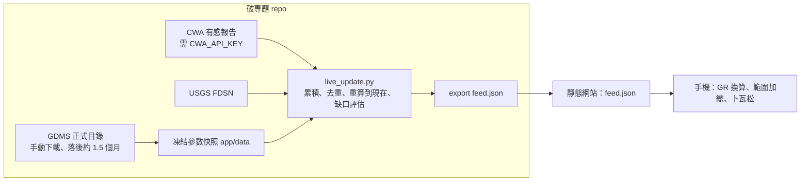

# 設計書（v0.6：Phase 5）

> 狀態：**Phase 2 已上線（2026-11-17）**：APP 讀破專題每 15 分鐘發布的 `feed.json`（v1.1 模型），執行時驗證、離線退回上次資料、超過 1 小時標示過期；「更多 → 最近的地震」由手機直接讀 ExpTech 地震報告（只顯示、不進入風險計算）。每 15 分鐘的更新由外部定時服務觸發（GitHub 內建排程實測不可靠，見 §10）。
> **Phase 3 已上線（2026-11-18，PR #2，§11）**：餘震卡、全台排行＋「幫我找」條件掃描、地震列表加強。下一步：用回測統計定狀態門檻；12/6 起凍結程式、只修錯誤。
> **Phase 4 已上線（2026-11-18，PR #3，§12）**：連續滑桿、我的情境（收藏）、分享網址。
> **Phase 5 已上線（2026-11-18，PR #4，§13）**：歷史回放、「我也會地震預測」`?q=` 預填、狀態門檻的回測檢查（維持 1.5／3／10 倍）。**12/6 起凍結程式、只修錯誤**（使用者確認）。待辦：iPhone 實機（使用者）；alpha＝0 修正與 365 天，使用者希望 12/9 前能做就做。
>
> 開發順序：1 PWA／免責／定位／地圖 → 2 真資料＋更新流程＋Py/TS 一致 → 3 餘震、排行榜、掃描器、地震列表 → 4 滑桿、收藏、分享 → **5 `?q=` 串接、歷史頁（本版）**。

## 1. 目標與定位

把破專題的「連續式風險函數」做成一般人看得懂的手機網頁 APP（PWA）。

- **大眾版**：打開就看到「我附近現在和平常比怎樣」，一個狀態、一個數字，不需要懂模型。
- **專家版**：「規模、時間、地點三選二」的三種檢視、回測驗證、原理與資料下載。

**為什麼用倍數決定顏色、而不是絕對機率**：M5 以上 3 天內的機率在台灣幾乎永遠是「個位數 %」，
單看絕對值無法判斷高低，也容易讓人以為「很低＝安全」。倍數（現在÷平常）才是模型帶來的資訊；
絕對機率仍放在下方，兩者都看。

## 2. 頁面清單

| 路由 | 頁面 | 內容 |
|---|---|---|
| （啟動時） | 使用前說明 | 第一次開啟的視窗：不是預報、不代表安全、以氣象署為準、資料延遲、僅供參考、位置不外送。「我了解」＋「不再顯示」 |
| `#/` | 大眾首頁 | 位置（鄉鎮區＋定位誤差）、條件、一個狀態（倍數＋顏色）、現在／平常機率、「回測涵蓋範圍／回測樣本有限／外推估計」標籤（§14）、最近的較大地震（餘震卡，有符合的地震才出現，§11.1）、全台排行（§11.2）、三個摺疊區（「換個情境看看」內有「幫我找」條件掃描）、安裝提示 |
| `#/info` | ⓘ 說明與資料狀態 | 目前條件的提醒、使用前說明、資料狀態、位置與隱私、安裝與更新、CARTO 金鑰、資料來源與授權 |
| 面板 | 選位置 | 我的情境（存／套用／刪除，§12.2）、使用目前位置、在地圖上點選、20 縣市 |
| 面板 | 調整條件 | 範圍、時間、規模：預設按鈕＋連續滑桿，下方即時預覽（§12.1） |
| `#/expert/map` | 風險地圖 | 每格機率／和平常比；點地圖換圓心、半徑滑桿、全螢幕、底圖切換、平滑 |
| 面板 | 地圖設定 | 平滑程度、底圖（全螢幕時另含規模與時間） |
| `#/expert/mag` | 換規模 | 地點＋時間 → 機率對規模；反查 50%／10%／1% 對應規模 |
| `#/expert/time` | 換時間 | 地點＋規模 → 機率對時間（1 小時～30 天） |
| `#/expert/verify` | 驗證與原理 | AUC 與預測÷實際矩陣、公式、地磁負結果、門檻、資料狀態 |
| `#/expert/more` | 更多 | 歷史回放（入口）、資料下載、最近地震（點一筆看震央附近的機率，§11.3）、參考資料 |
| `#/history` | 歷史回放 | 2016 美濃、2018 花蓮、2022 池上、2024 花蓮地震，各 4 個時間點；點了整個 APP 換成那時的狀態（§13.1） |
| 面板 | 一筆地震 | 時間、最大震度、深度、地點，與震央周圍之後再發生地震的機率（§11.3） |
| 面板 | 分享 | 條件、「附上位置」（GPS 位置預設不勾）、連結；系統分享或複製（§12.3） |

**為什麼把提醒移到 ⓘ 頁**：雛型把「可能低估 N%」「回測偏高估」等黃色警示直接放在首頁，試用後發現提醒一多，
最重要的那句（不是預報）反而沒人看。現在首頁只留一個不顯眼的標籤（回測涵蓋範圍／回測樣本有限／外推估計，§14）和「資料說明（N 則提醒）」連結，
細節集中在 ⓘ 頁。假資料階段的黃色提示條仍然保留——數字是假的這件事不能藏。

## 3. 使用案例

## 4. 資料流程（接真資料後；Phase 2 會再確認架構）

- 後端只給「每格 × 10 個時間長度的 M≥3.5 期望數」（完整模型與平常各一份）、b、m_ref、資料狀態、近期地震、回測表。格式見 `src/data/schema.ts`。
- 手機端做：log–log 時間內插、古騰堡–芮克特換算、點範圍面積比例（10×10 子點）、卜瓦松。對應 `app/hazard_core.py`。
- **驗證層**：Phase 2 加對照測試——同一組輸入，TS 與 Python 結果相對誤差 < 1e-9。
- **位置隱私**：定位只在手機端算；存到 localStorage 前降低精度（GPS 0.01°、地圖選點 0.001°）；從不送出。

## 5. 狀態門檻（2026-11-18 回測檢查過）

| 倍數 | 標題 | 顏色 |
|---|---|---|
| < 1.5 | 和平常差不多 | 灰 |
| 1.5–3 | 比平常高一些 | 黃 |
| 3–10 | 比平常高不少 | 橘 |
| ≥ 10 | 遠高於平常 | 紅 |

- 刻意**不用綠色、不說「安全」「無需注意」**：台灣本來就常有地震。
- 位置在模型網格外（或圓形範圍有一半以上在外面）時**不顯示狀態**，改顯示「目前模型未涵蓋此區域」，並註明「這不代表這裡沒有地震風險」。
  雛型在這種情況會算出平常機率 0、倍數無限大，顯示成「遠高於平常」——是錯的，本版已修正（`assessPoint` 的 `covered`）。
- **回測檢查（2026-11-18，§13.3）**：測試期 2015–2026 每天、20 個縣市、預設條件（50 km、3 天、M5），各狀態出現的比例：差不多 80.5%、高一些 16.6%、高不少 2.7%、遠高於 0.2%。「高不少」以上約一個月一次，符合「不要天天出現」的目標，**門檻維持不變**。

## 6. PWA：可安裝與離線

**為什麼自己寫 service worker，不用現成套件**：現成的 PWA 套件會帶進 Workbox 與 Babel 一長串相依（C 槽空間有限）；
我們需要的只有「把輸出檔清單與版本雜湊填進樣板」，寫在 `vite.config.ts` 的 `swPlugin` 約三十行，也比較看得懂。

| 項目 | 做法 | 原因 |
|---|---|---|
| 圖示 | 192／512 PNG（any 與 maskable 各一組）、180 的 apple-touch-icon；`scripts/make_icons.py` 產生 | Chrome 的安裝條件要 PNG；iPhone 不吃 SVG；maskable 會被裁切所以內容要縮在安全區 |
| 頁面（index.html） | 先走網路，逾時 4 秒或離線才用快取 | 有網路時一定拿到最新版，不會卡在舊版 |
| 自己的靜態檔 | 先用快取（檔名帶雜湊） | 開啟快、可離線 |
| 地圖圖磚 | **完全不攔截、不另外存** | OSM 禁止預抓與離線；CARTO 禁止存超過 30 天 |
| 新版 | 裝好後等待，全部關掉再開才換；ⓘ 頁可「檢查更新／套用新版」 | 不打斷正在看的畫面，又能手動確認手機上是最新版 |
| 建置檢查 | `scripts/check-dist.mjs`（`npm run build` 的最後一步） | 圖示尺寸不符、預存清單有不存在的檔案，都只會在使用者手機上默默失敗 |

**已驗證**（2026-11-16，Chromium，正式建置）：manifest 解析無錯誤；service worker 接手頁面；
`Page.getInstallabilityErrors` 除了測試環境的無痕視窗外沒有其他項目；斷網後重新載入可開啟，鄉鎮區界線檔讀得到。
**實機**：Android 已由使用者確認可開啟、可安裝（2026-11-17）；iPhone 尚未驗證。

## 7. 鄉鎮區本機判斷

**為什麼不查 API**：國土測繪中心有「坐標回傳行政區」的開放 API，但那等於把使用者的位置送出去。
改成把界線檔簡化後內建在 APP，全部在手機上算。

- **資料**：內政部國土測繪中心「鄉鎮市區界線(TWD97經緯度)」1140318 版（政府資料開放授權條款－第1版）。原始檔 18 MB。
- **簡化**（`scripts/build-towns.mjs`）：mapshaper，Douglas–Peucker `interval=50`（公尺）＋ TopoJSON 量化 → `src/data/towns.topo.json` 298 KB（傳輸約 88 KB）、368 個鄉鎮市區。
  選 Douglas–Peucker 是因為它**保證**簡化後的線和原本的線相差不超過指定距離；加上量化誤差，上限是 **61 公尺**（寫在檔案的 `meta.tolerance_m`）。
- **判斷規則**（`src/geo/towns.ts`）：把「定位誤差＋61 公尺」當成不確定半徑。

| 情況 | 顯示 |
|---|---|
| 在某區內，半徑內沒有別的鄉鎮區 | 高雄市三民區 ＋ 定位誤差約 30 公尺 |
| 在某區內，半徑內還有別的鄉鎮區 | 高雄市三民區**附近** ＋ 定位誤差約 850 公尺 |
| 不在任何區內（海上），20 公里內有鄉鎮區 | 花蓮縣花蓮市**附近** ＋ 離岸約 3.2 公里 |
| 更遠 | 座標（23.90°N, 122.20°E） |

- **驗證層**（`src/geo/towns.test.ts`）：沿原始界線每 8 公里取一點、隨機偏移 0–200 公尺，再加 300 個隨機點，共 1,365 點；
  用 mapshaper 對**原始**界線判斷當標準答案（和 APP 的程式互相獨立）。結果：APP 說「有把握」的 391 點**全部正確**。
- **已知限制**：
  - 比誤差上限還小的島礁會被簡化掉（1,073 個陸地對照點中有 2 個：澎湖西嶼鄉的小島、恆春外海的七星岩），那裡會顯示成最近鄉鎮區的「附近」。
  - 屏東縣瑪家鄉三和村是飛地，內政部版界線檔把它另外放在補充檔；本 APP 只用主檔，那裡會顯示成周圍的鄉鎮。
  - 界線是 2025 年 3 月的版本，之後的行政區調整要重跑腳本。

## 8. 地圖

- **點地圖換圓心**：圓心就是首頁用的「位置」。點到地震圓點只看它的資訊，不換圓心。
- **半徑滑桿**：5–200 km。拖的時候只更新圓與數字，放開才存。小於一格（約 22 km）時是把那一格的機率依面積比例分配，ⓘ 頁會提醒。
- **全螢幕**：用 CSS 把地圖區塊蓋滿畫面，不用瀏覽器的 Fullscreen API（iPhone 不支援）。
- **地圖不跟著整頁重畫**：APP 每次狀態改變都整頁重畫，但 Leaflet 的容器由 `ui/map.ts` 自己留著，所以換條件不會跳回原位、也不會重抓圖磚。
- **平滑化（只是顯示效果）**：把 0.2° 格子的值在對數空間做雙線性內插（可再加高斯模糊），畫成一張影像貼上去。
  **沒有重算 0.1°、沒有重做回測**；模型解析度仍是 0.2°。所以：平滑開啟時畫面有註明；點選顯示的數字一律取原始格子；
  影像的列依麥卡托投影排列（用緯度等分的話中段會偏約 2.6 公里）。

### 底圖與授權（2026-11-15 查證）

| 底圖 | 金鑰 | 條款重點 | 來源標示 |
|---|---|---|---|
| OpenStreetMap（淡化、深色） | 否 | 須清楚標示；禁止預抓與離線；要送 Referer | © OpenStreetMap contributors |
| OpenTopoMap | 否 | CC-BY-SA；不保證可用性；勿大量下載 | 地圖資料 © OpenStreetMap contributors、SRTM｜地圖樣式 © OpenTopoMap（CC-BY-SA） |
| 國土測繪中心 通用電子地圖（EMAP）、正射影像（PHOTO2） | 否 | 官方「免申請服務介接說明表」（113/1/3）列為免申請、對象不限。**沒查到流量上限與標示格式的明文**，採保守做法 | 圖資來源：內政部國土測繪中心 |
| CARTO Voyager／Positron／Dark Matter | **是** | 2026-09-25 起必須帶金鑰；金鑰放在圖磚網址；可設網域限制；**禁止伺服器端代理或快取**；裝置端快取不得超過 30 天；非商業每月 500 萬張 | © OpenStreetMap contributors, © CARTO |

**CARTO 金鑰怎麼放**：金鑰本來就會出現在瀏覽器的圖磚網址裡（CARTO 的設計，靠後台的網域限制保護），
而且條款禁止用自己的伺服器代理，所以「完全藏起來」做不到。目前的做法是**使用者在 ⓘ 頁貼上自己的金鑰，只存在那支手機**——
repo 與網站都不含金鑰。程式也支援建置時的 `VITE_CARTO_KEY`（會打包進公開網站），要不要啟用由專案擁有者決定；
啟用的話務必在 CARTO 後台把金鑰限制在 `azazelowo.github.io`。

## 9. 風險與對策

| 風險 | 對策 |
|---|---|
| 一般人把機率當預報 | 第一次開啟的說明視窗；每頁頁尾「不是地震預報」；措辭避免確定語氣 |
| 「和平常差不多」被讀成安全 | 副標題「台灣本來就常有地震，防震準備照常」；不用綠色 |
| 網格外的位置被算成高風險或零風險 | `covered` 判斷，顯示「目前模型未涵蓋此區域」 |
| 鄉鎮區講錯 | 誤差上限＋「附近」；對照原始界線的測試 |
| 平滑後的圖被當成更高解析度 | 畫面註明；數字取原始格子 |
| 手機卡在舊版 | 頁面先走網路；ⓘ 頁顯示版本與「檢查更新」 |
| 底圖服務改政策或掛掉 | 五種免金鑰底圖可切換；載入失敗時地圖上有提示；沒網路時格子仍顯示 |
| 金鑰外洩 | 金鑰只存使用者裝置；`.env*` 不進 git；建置檢查發現內建金鑰時會提醒 |
| TS 與 Python 算法分歧 | 對照測試（Phase 2） |
| GitHub 內建排程延遲或停擺，資料沒更新 | 外部定時服務每 15 分鐘觸發（§10）；APP 超過 1 小時標示過期 |
| 餘震卡在大地震剛發生時偏低（v1.1 模型 alpha＝0） | 卡片上直接寫「可能偏低」與原因，不藏到 ⓘ 頁；模型修正排在 12/9 之後（§11） |

## 10. 之後的步驟

1. **Phase 2（已實作）**：架構（2026-11-17 使用者確認）——
   - **風險數值**：破專題 `app/live_update.py`＋`app/export_feed.py`，`.github/workflows/hourly-feed.yml` 每 15 分鐘用氣象署開放資料（`CWA_API_KEY` Secret）＋USGS 重算、推到 feed 分支。金鑰只在 Actions，不進前端。不用 ExpTech 算風險：條款要求使用者直連、不得經自己的伺服器轉發，TREM 也不得用於預測。
   - **地震列表**：手機直接呼叫 ExpTech `/api/v2/eq/report`（免 Token、CORS 開放，三台主機依序備援），標示「資料來源：中央氣象署、ExpTech Studio（exptech.dev）」；連不上就用 feed 裡的地震。請求不帶位置。
   - **USGS**：只當 Actions 的補充來源（M4 以上），不直接給手機。
   - APP `src/data/feed.ts`（驗證、快取、退回、過期標示）、`src/data/exptech.ts`、畫面出錯時顯示錯誤卡片而非空白（審查 H3）。
   - **TS／Python 一致性**：`src/core/parity.test.ts` 讀破專題 `app/export_parity.py` 產生的對照資料，相對誤差 < 1e-9。
   - **上線**（2026-11-17）：破專題 PR #23 合併、`CWA_API_KEY` Secret 已設、第一次手動執行成功，APP 讀到真資料。
   - **定時觸發（2026-11-18 改）**：GitHub 內建排程實測不可靠——上線後數小時一次都沒有自動執行，同 repo 其他排程也晚 3～9 小時。
     改由使用者在 cron-job.org 設定每 15 分鐘呼叫 GitHub 的 `workflow_dispatch` API（`hourly-feed.yml`、ref `main`）。
     權杖是使用者自建的 fine-grained token：只限破專題 repo、只有 Actions 讀寫，不在任何 repo 裡。
     工作流程內的 cron 保留當備援；兩邊同時觸發會依序執行（`concurrency`），結果相同、不會衝突。
     - **會讓更新停掉的事**：權杖到期（**2027-11-18 到期**，到時重建並換到 cron-job.org）；工作流程改檔名或拿掉 `workflow_dispatch`；cron-job.org 停用這個工作。發生時 APP 會在 1 小時後顯示「資料已過期」。
   - **尚未做**：iPhone 實機測試。
2. **Phase 3（已完成，§11）**：餘震機率預估、首頁「目前全台風險排行榜」、條件掃描器（依倍數排序、只收 p≥1%）、地震列表。
3. ~~用回測統計定狀態門檻~~：已完成（§5、§13.3），維持 1.5／3／10 倍。
4. ~~「我也會地震預測」加 `?q=`~~：已完成（§13.2，該 repo 的改動）。
5. **Phase 4（已完成，§12）**：連續滑桿、我的情境（收藏，只存本機）、分享網址。
6. 歷史回放已完成（§13.1）。有空就做：斷層圖層、震度；12/9 之後：時間延長到 365 天、修正 alpha＝0。

## 11. Phase 3（2026-11-18 起）

**範圍與順序（2026-11-18 使用者確認「全部照建議」）**：餘震卡 → 全台排行榜＋條件掃描器 → 地震列表加強；一項一項上線，12/6 起凍結程式、只修錯誤（破專題審查報告 §4.6 的建議）。排行用縣市為單位；餘震用現有模型；不開多代理。

**和規劃文件的落差（使用者已決定）**：破專題審查報告 §4.6 原本寫「Phase 3 只做全台排行」；SA&D 08 專案管理因資源過載 25% 建議全台排行延到 12/9 後。Phase 2 比計畫提早上線（原排 11/22–11/30，實際 11/17），所以三項都做。

**先知道：沒有大地震時畫面很平淡**。2026-11-18 08:30 的真資料試算：20 縣市 × 各種規模與時間，倍數全部在 0.39–1.18；模型資料近 7 天沒有 M5 以上。這是誠實的結果。倍數低於 1 是正常的：「平常」是包含過去大地震餘震期的長期平均，平靜時「現在」會比它低（畫面上 1.15 倍以下一律寫「約 1 倍」）。上台展示另備錄影、截圖。

### 11.1 餘震卡（首頁，已完成）

| 項目 | 做法 |
|---|---|
| 挑哪個地震 | `feed.recent` 裡，資料發布前 7 天內 M5 以上、或 30 天內 M6 以上的地震中規模最大的（同規模取較近的）；沒有就整張不出現（`src/core/aftershock.ts`） |
| 數字 | 震央周圍 50 km，M4／M5 以上 × 1／7／30 天的「現在」與「平常」。用 `assessCircle`——和首頁的 `assessPoint` 完全相同，只是面積比例先算好一次。**沒有新的數學**，TS／Python 一致性測試已涵蓋 |
| 震央位置文字 | 在鄉鎮區內講名字；在外面講「離 XX 約 N 公里」；80 km 內沒有鄉鎮區就給座標（`epicenterText`）。不說「海上」：網格西北角有中國大陸沿岸。界線檔在手機上判斷，不送出位置；還沒載入時先給座標 |
| 模型範圍外 | 震央周圍大半在網格外：不給數字，並寫「這不代表那裡不會有餘震」 |

**為什麼沒有另外做餘震模型**：Reasenberg–Jones（1989）這類專門的餘震公式，參數要有可查證的出處（原文是加州的通用參數），而且要在破專題 `hazard_core.py` 和 APP 兩邊實作、加進對照測試，畫面上還會同時出現兩套模型的數字。12/9 前先用現有模型，把限制寫清楚。

**限制（直接寫在卡片上，不藏到 ⓘ 頁）**：
- v1.1 模型 alpha＝0（擬合結果卡在搜尋範圍下限）：規模不影響近期加成，大地震和小地震被當成會帶來一樣多的餘震，**大地震剛發生時偏低**，要等餘震陸續進到資料裡才追上。修正排在 12/9 之後（破專題 `docs/reports/hazard_v1/README.md` 已知限制 3）。
- 模型不分主震、餘震：算的是震央附近「再發生地震」的機率，包含平常就會有的地震。
- 外海定位差的地震不在模型裡；新地震要等下一次資料更新（每 15 分鐘）才算進去。

**驗證**：`src/core/aftershock.test.ts`（挑選規則與邊界、和 `assessPoint` 相同、範圍外標成未涵蓋）、`src/ui/public.test.ts`（措辭、範圍外不出現百分比）、`src/geo/towns.test.ts`（震央文字）。375px 用假資料（花蓮外海 M5.8）看過深色與淺色。

**順手修正**：整頁重畫時，摺疊區的展開狀態原本用「第幾個」對應；餘震卡會依資料出現或消失，順序一變就會展開錯的區塊。改成用 `data-fold` 或標題文字對應（`main.ts` 的 `foldKey`）。

### 11.2 全台排行與「幫我找」條件掃描（首頁，已完成）

| 項目 | 做法 |
|---|---|
| 全台排行 | 模型範圍內 20 個縣市（代表點和「選位置」的縣市按鈕相同）× 規模 M4–M7 × 時間 1 小時–30 天，範圍固定周圍 50 km。**只收現在機率 ≥ 1%**、依倍數排序、**每個縣市只取倍數最高的一組**（不然會被同一個縣市洗版：2026-11-18 試算時前三名都是臺南）。首頁列前 3 名，展開看前 10 名；點一項就換成那個縣市（50 km）和那組條件 |
| 全部和平常差不多時 | 第一名也沒到「比平常高一些」（1.5 倍）：不列名次，改寫「目前全台沒有明顯高於平常的地方（最高約 N 倍）」；展開仍看得到排序，並註明「排在前面不代表那裡比較危險」 |
| 幫我找（條件掃描） | 在「換個情境看看」裡：目前位置與目前範圍，所有規模 × 時間掃一遍，同樣只收 p ≥ 1%、依倍數排序，列前 10 組；點一項就套用那組規模與時間。模型範圍外不給任何組合 |
| 計算 | `src/core/scan.ts`：每個地點的 `pointWeights` 只算一次，再用 `assessCircle` 換規模與時間——和首頁同一套計算，**沒有新的數學**；篩選、排序屬於畫面邏輯（`scan.test.ts`）。全台排行只和資料有關，同一份資料只算一次（`WeakMap` 快取） |
| 措辭 | 標題「和平常比，倍數最高的地方」，不寫「最危險」；卡片寫「統計機率，不是地震預報」；顏色同狀態門檻（灰／黃／橘／紅，沒有綠色） |

**為什麼用縣市代表點＋固定半徑，不用鄉鎮區面積**（2026-11-18 使用者確認）：和首頁問的是同一個問題（周圍 50 km），數字可以直接比，也不用新計算。審查報告提到的「多邊形和網格面積交集」是新數學，要兩邊實作；而且面積大的山區鄉鎮機率天生較高，「只收 1% 以上」會讓小的市區幾乎上不了榜。鄉鎮區代表點（368 個）則因為相鄰鄉鎮的 50 km 圓幾乎重疊，前幾名會擠在同一帶。

**已知特性**：倍數是「機率」的比。機率接近 100% 的組合（例如花蓮 M4、30 天）倍數會被壓向 1，所以平靜時這類組合反而排在前面、有活動時排在後面；每個地點選到的通常是機率剛過 1% 的那一組。這是「依倍數排序、只收 p ≥ 1%」規則本身的結果；平靜時名次收起來，不會誤導。

**驗證**：`src/core/scan.test.ts`（只收 p ≥ 1%、排序、每縣市一次、和 `assessPoint` 相同、金門連江不上榜、假資料花蓮第一）、`src/ui/public.test.ts`（措辭、平靜時收起、範圍外不給組合）。375px 看過真資料（平靜，全部約 1 倍）與假資料（花蓮 M5、1 天 4.3 倍排第一）；點第一名後首頁顯示花蓮縣、50 km、1 天、M5，倍數 4.3 和排行一致。

**順手修正**：`.fold summary` 的樣式原本也套到摺疊區裡面的摺疊區（例如「幫我找」），外層展開時裡面的標記也變成「－」；改成只套直接子元素。

### 11.3 地震列表加強（「更多 → 最近的地震」，已完成）

| 項目 | 做法 |
|---|---|
| 還沒算進風險數字 | 發生在這次風險資料發布之後、而且規模到模型計數門檻（M≥m_ref＝3.5）的地震，標「還沒算進風險數字」（`notYetCounted`）。只標「之後」的：ExpTech 和模型的資料來源不同，沒辦法一筆一筆對上，所以不宣稱哪一筆「已算進」。M3.5 以下的地震本來就不影響模型（破專題的目錄只計 M≥m_ref），列表上直接寫明 |
| 點一筆 | 打開底部面板：時間、最大震度、深度、氣象署的地點文字，以及震央周圍 50 km 之後再發生地震的機率（和首頁餘震卡同一段畫面，`src/ui/outlook.ts`）。地震發生在資料之後、又會影響模型時**不給數字**：那時的數字還沒反映它，看起來會像「沒有升高」 |
| 只更新列表 | 每 2 分鐘抓一次列表時只換 `#recent-quakes` 這一塊，不整頁重畫（審查 E4）：開著的面板、捲動位置、展開的區塊都不受影響 |
| 鍵盤 | 每一列是 `role="button"`、可以用 Tab 移到，Enter／空白鍵打開 |

**驗證**：`src/ui/quakes.test.ts`（標記規則、面板何時給數字、範圍外不給數字、外部字串跳脫）、`src/data/exptech.test.ts`（列可點、標記）。375px：桌面 APP 的瀏覽器面板看不到時截圖會停在舊畫面，改用 Edge 無頭模式（DevTools 協定，375×812）在列表最前面插一筆「2 分鐘前 M5.2」的測試地震：看過標記、兩種面板（不給數字／給數字），以及 2 分鐘後列表自動更新時只換列表、標題列沒有重建、面板仍開著。

## 12. Phase 4（2026-11-18 起）

**範圍與順序（2026-11-18 使用者確認「全部照建議」）**：連續滑桿 → 我的情境（收藏）→ 分享網址；一項一項上線，合併前先問。不開多代理。
使用者 11/15 的原話：「連續滑桿模式：半徑 10～300 km、時間 1～365 天、規模 M4.0～M8.0，並保留快速預設按鈕」「我的情境：例如高雄住家、高科大、全台 M6+、南海海槽」「分享網址直接還原目前條件」。

### 12.1 連續滑桿（已完成）

| 項目 | 做法 |
|---|---|
| 位置 | 「調整條件」面板：每排預設按鈕下面一條滑桿，面板下方即時預覽（地點＋條件→現在／平常／倍數＋回測標籤）。專家版的地圖（規模、時間）、規模（半徑、時間）、時間（半徑、規模）也有 |
| 範圍 | 半徑 5–200 km（每 5 km）；時間 1 小時–30 天（**對數刻度**，1 小時到 1 天、1 天到 30 天各佔差不多的長度），取到畫面顯示的精度（1 天內 0.1 小時、10 天內 0.1 天、再長整天）；規模 M4.0–M8.0（每 0.1） |
| 和原話不同的地方（使用者確認） | **時間上限 30 天**：feed 只匯出到 30 天，超過算不出來；365 天要破專題多匯出時間長度、重新校準、更新對照測試，排在 12/9 之後。**半徑上限 200 km**：300 km 時 6 個縣市代表點只有 54–70% 在網格內（臺北 54%），網格外不計入，數字明顯偏低；200 km 時 69–99% |
| 外推 | 規模 6.5 以上、時間在回測範圍外：只標「外推估計」，不跳窗、首頁不放醒目警示（定案 C）。範圍有一部分在網格外時 ⓘ 頁提醒（`conditionNotes`） |
| 操作 | 拖的時候只更新旁邊的數字與預覽（`input`），放開才存檔、整頁重畫（`change`）；鍵盤方向鍵也可以調 |
| 計算 | 任意半徑、規模，以及 1 小時–30 天之間任意時間，都是現有的計算（時間在刻度之間用 log–log 內插，對照測試已涵蓋），**沒有新的數學** |
| 順手修正（審查 Q6） | 本機存的條件原本只檢查 `T > 0`，超過 30 天會讓整頁算不出來；分享網址會讓外部輸入走到這裡。改成 `validCond`：半徑、時間、規模都要在上面的範圍內，否則用預設值 |

**驗證**：`src/app.test.ts`（對數刻度兩端與單調、和預設值互相換算、夾範圍、Q6）、`src/ui/public.test.ts`（面板有三排按鈕與三條滑桿、預覽的回測標籤、範圍外不給數字、專家版有滑桿）。375px（Edge 無頭模式）：拖動中只更新數字與預覽、放開後面板仍開著、首頁條件變成「周圍 120 km・2.2 天內・M6.8 以上」並標外推估計、專家版時間頁沒有橫向捲動。

### 12.2 我的情境（收藏，已完成）

| 項目 | 做法 |
|---|---|
| 位置 | 「選擇位置」面板最上面：已存的情境（點了套用、✕ 刪除，刪除前確認），下面「＋ 把目前的位置和條件存起來」：名稱＋「目前位置周圍」或「全台」二選一 |
| 存什麼 | 名稱（最多 20 字，去掉控制字元）＋位置＋條件；同名的直接換掉，最多 12 個（`src/favs.ts`） |
| 只存本機（定案 J） | `localStorage`（`eqrisk.favs.v1`），不上傳。座標先降精度，規則和「記住目前位置」相同：GPS 0.01°、地圖選點 0.001°、縣市用固定代表點。**GPS 位置存成情境後變成固定點**（不存定位誤差），下次開 APP 不會被自動定位換掉。ⓘ 頁「位置與隱私」有寫 |
| 「全台」情境 | 首頁永遠是「周圍幾公里」，沒有全台模式，所以「全台 M6+」這類情境不存位置，套用時換成那組規模與時間並打開專家版的全台地圖（2026-11-18 使用者確認） |
| 範圍外 | 例如「南海海槽」：位置在模型網格外，套用後照常顯示「目前模型未涵蓋此區域」（定案 E） |
| 讀回來 | 逐筆檢查（可能被改過或是舊格式）：條件要在滑桿範圍內（`validCond`）、位置格式要對（`sanitizePlace`），看不懂的整筆丟掉；名稱畫面上一律跳脫。存不了（無痕模式）時表單上直接說「沒有存起來」 |
| 重畫 | 「目前位置／全台」用 radio，切換時不重畫；整頁重畫（例如資料更新）時保留打到一半的名稱與選項 |

**驗證**：`src/favs.test.ts`（GPS 降精度並變固定點、全台不存位置、名稱清理、同名覆蓋、滿 12 個、讀回逐筆檢查）、`src/ui/public.test.ts`（空清單說明、名稱跳脫、說明文字）。375px（Edge 無頭模式）實際操作：存「高雄住家」與「全台M6+」、存好後表單收起、套用後首頁顯示「高雄市・我的情境：高雄住家」與它的條件、套用全台打開地圖且條件是 M6・7 天、刪除後重新整理仍正確。

### 12.3 分享網址（已完成）

| 項目 | 做法 |
|---|---|
| 入口 | 首頁更新時間那一行的「分享」→ 分享面板：條件、「附上位置」勾選框、連結本身；手機有系統分享就多一顆「分享…」，否則只有「複製連結」（剪貼簿不能用時改成選取連結文字，請使用者長按複製） |
| 網址 | `…/#/?r=50&t=3&m=5` 加上位置：縣市用 `c=縣市名稱`（對方用內建代表點），其他用 `lat`、`lon`（取到 0.01°，約 1 公里）。**地點名稱不放進網址**（`src/share.ts`） |
| 位置隱私（使用者確認） | 選縣市、地圖選點：預設附上；**GPS 定位的位置、以及由 GPS 存成的「我的情境」（`personal`）預設不附**，面板上寫明原因（連結會留在聊天紀錄裡），使用者自己勾才附。APP 不會自己把連結傳出去：交給系統分享或剪貼簿，傳給誰由使用者決定。ⓘ 頁「位置與隱私」有寫 |
| 收到連結 | 數字一律夾在滑桿範圍內並取到刻度（審查 Q6）；縣市名稱必須和內建清單完全相同；網址裡的任何文字都不會出現在畫面上——座標的地點名稱在收到的手機上自己判斷（界線檔，不外送），標「分享的位置」。缺的參數沿用對方自己的設定 |
| 套用之後 | 首頁最上面提醒「已套用分享連結的位置和條件」（可關）；網址換回 `#/`（重新整理不會再套一次，網址列也不留別人的位置）；這次開啟不自動定位，免得 GPS 蓋掉分享的位置。APP 開著時又點進分享連結（`hashchange`）也一樣處理 |

**驗證**：`src/share.test.ts`（縣市只放名稱、座標 0.01°、GPS 與 `personal` 預設不附且不勾就完全沒有位置、地名不進網址、產生→解析一致、超出範圍夾回、假縣市名稱與網址文字不採用、不是分享網址不處理）、`src/ui/public.test.ts`（面板勾選預設、GPS 說明、有無系統分享、首頁的分享入口與提醒）。375px（Edge 無頭模式）：縣市與 GPS 兩種面板、勾選後連結才出現座標、APP 開著時打開分享連結、從零開啟分享連結（地名判斷成「臺中市北區・分享的位置」、網址換回 `#/`），以及惡意網址（`r=99999&t=999&m=-5`、`c=`）：數字夾回 200 km・30 天・M4、位置不變、網址裡的程式碼沒有執行、沒有錯誤卡片。

## 13. Phase 5（2026-11-18）

使用者 2026-11-18：「完成Phase 5 把所有東東弄完 彙整並告訴我結果 跟需要我解決確認的問題」。範圍＝開發順序第 5 項（`?q=` 串接、歷史頁），加上之前列為「還沒做」的狀態門檻回測與破專題文件。

### 13.1 歷史回放（`#/history`）

| 項目 | 做法 |
|---|---|
| 資料 | 破專題 `app/export_history.py` 產生 `public/history/`：`index.json`＋16 份和 feed.json 同格式的檔案（2016 美濃、2018 花蓮、2022 池上、2024 花蓮地震 × 主震前 1 小時、主震後 1 小時／1 天／7 天）。每份約 130–160 KB，共約 2.3 MB |
| 不偷看未來 | 參數用 v1.1（1995–2014 擬合），這些地震都在測試期；每格期望數只用那個時間點之前的地震，校準倍率也用那之前 730 天內已結束的預報窗（`trailing_factor`，和正式匯出同一個做法）；走和即時 feed 相同的 `load_snapshot → build_feed → check_feed`。破專題測試確認「之後的地震不會改變當時的數字」 |
| 和當時真的跑不同 | 用的是事後整理好的正式目錄；當時即時的資料比較不完整，近期加成會比這裡低一些。回放頁與提示列都寫明「用事後資料重算的當時狀態，不是現在」 |
| 進入回放 | 點一個時間點：feed 換成那時的資料、位置換到震央、條件回到預設（50 km・3 天・M5，各時間點才好比較），回到首頁。整個 APP（狀態、餘震卡、全台排行、地圖、規模／時間曲線）都照常計算 |
| 回放中 | 每頁上方提示列（「歷史回放・地震・時間點……不是現在」＋換時間點＋回到現在）；不存檔（`save` 略過）、不自動抓新資料、隱藏分享；更新時間那行改成「回放的時間點」；餘震卡的「多久以前」以回放時間點計算；更多頁的地震列表換成回放時間點之前 30 天（正式目錄）。重新整理就回到現在 |
| 回到現在 | 還原進入前的位置與條件、換回最新的 feed |
| 檔案 | 不放進 service worker 的預存清單（點開才下載，看過的由 runtime 快取留著）；`check-dist.mjs` 檢查清單上每個時間點都有檔案、預存清單不含 `history/` |
| 列表 | 只放模型網格內的地震（2016-02-02 東經 123.5° 的深源 M6.7 在網格外，原本會讓美濃地震的餘震卡挑錯地震） |

**看到什麼**（APP 首頁的計算）：
- 主震前 1 小時，震央周圍 50 km・3 天・M5 以上：2016 美濃 0.48 倍（完全平靜，模型看不出任何東西）；2018 花蓮 7.4 倍、2022 池上 15 倍（之前都有前震，池上是前一天的關山 ML 6.6）；2024 花蓮 1.6 倍（兩週前有 M5.4），預設條件下縣市第一是澎湖、臺南。模型只會因為已經發生的地震而升高，不知道哪一次會變成更大的主震——這不是預報。
- 主震後 1 小時：2024 花蓮震央 7.1 倍（M4 以上 1 天內 67%，平常 7.6%；排行花蓮 49 倍）、2016 美濃 5.6 倍、2018 花蓮 9.9 倍、2022 池上 18.7 倍。
- 2024 花蓮主震後 2 分鐘（`state_frequency.py` 的 08:00 發布）：花蓮只有約 1.8 倍——alpha＝0，要等餘震進來才追上，正是卡片上寫的「大地震剛發生時偏低」。

**驗證**：破專題 `pipeline/tests/test_export_history.py`（找主震、不偷看未來、主震後震央升高、輸出通過 check_feed 且列表只有之前的地震）；APP `src/data/history.test.ts`（清單代碼只能是安全字元、16 份全部通過 validateFeed、發布時間一致、主震後 1 小時的餘震卡挑到該主震）、`src/ui/history.test.ts`（跳脫、限制文字、提示列、回放中沒有分享、多久以前）。375px（Edge 無頭模式）：清單、進入 2024 花蓮主震後 1 小時、首頁／餘震卡／排行／地圖／更多頁、回放中沒有存檔、回到現在後位置與條件還原、2022 池上主震前 1 小時、驗證頁的門檻說明。

### 13.2 「我也會地震預測」`?q=` 預填（i-can-predict-quakes repo）

APP 首頁「更多」裡的「拿去算算看」本來就會帶 `?q=<句子>`。這次在那個 repo 加上讀取：句子填進輸入框並提示「從連結帶進來、還沒送出」，**不自動送出**（仍要按「算算看」、經過輸入把關與確認卡，使用者定案 F）；讀完立刻用 `history.replaceState` 把 q 從網址拿掉，原文不留在網址列與瀏覽紀錄（該 repo 規則 3）。PR：Azazelowo/i-can-predict-quakes#1（1,111 個測試、建置通過；Edge 無頭模式確認）。

### 13.3 狀態門檻的回測檢查

破專題 `app/state_frequency.py`（報告 `docs/reports/state_frequency.md`）：測試期 2015-01-01～2026-09-30 每天台灣時間 08:00、20 個縣市代表點、首頁預設條件，計算和首頁相同（現在÷平常）。

| 狀態 | 所有縣市×天 | 全台排行第一名 |
|---|---|---|
| 和平常差不多 | 80.5% | 10.1% |
| 比平常高一些 | 16.6% | 62.9% |
| 比平常高不少 | 2.7% | 24.9% |
| 遠高於平常 | 0.2% | 2.1% |

「高不少」以上一般地點約一個月一次（花蓮 12%、臺南 11% 較常見，臺中、彰化、南投、苗栗 0%），符合設計目標，**門檻維持 1.5／3／10 倍**；驗證頁的說明改成顯示這些數字（`format.ts` 的 `LEVEL_BACKTEST`）。排行第一名九成的天數至少「高一些」，所以平常排行卡多半會列出名次；全部低於 1.5 倍時才收起。

### 13.4 破專題的文件

`app/README.md` 與 `hourly-feed.yml` 開頭寫明「實際由外部服務（cron-job.org）呼叫 `workflow_dispatch`、改檔名或拿掉它更新就會停」；SA&D 02 的 FR-13、FR-14 改成完成、08 的 WBS 5.3 打勾。PR：Azazelowo/earthquake-risk-project#25（185 個測試通過）。

## 14. 回測標籤與文件修正（2026-11-20，外部回饋）

外部檢查（ChatGPT 讀程式碼與 feed，沒有實機操作）指出三點，查證都屬實：

1. **README 還寫「目前的數字都是假資料」**：已改成真資料說明，加「資料狀態」表（正式目錄、暫時資料、缺口低估、更新、離線、網格）與限制（大地震後偏低、回測涵蓋不等於可信）。
2. **「已驗證範圍」不看樣本數**：`isVerified()` 只看規模與時間是否在回測範圍內，但線上 feed 有 M5・1 小時只有 4 個地震（預測÷實際 0.46）、M6・1 天 5 個（1.68）。改成三種標籤（`backtestTag()`）：
   - **回測涵蓋範圍**：在範圍內，且最接近的回測組（`nearestBacktest()`，和 `reliabilityNotes()` 同一個距離）有 ≥ 20 個地震；
   - **回測樣本有限**：在範圍內但不到 20 個（`MIN_BACKTEST_EVENTS`，和既有的可信度提示同一門檻）；
   - **外推估計**：範圍外（不變）。
   「已驗證」改成「回測涵蓋」：回測做過不等於證明可靠，AUC 也只代表分辨能力、不代表機率校準。
3. **回測矩陣的樣本數放在 `title`，手機看不到**：每格直接顯示 `n=…`，不到 20 個粗體標色；矩陣下方說明 n 的意思與 AUC／預測÷實際的差別。

只改標籤與文字，不改任何機率。首頁仍維持「不放醒目警示」的決定（2026-11-15），資料缺口的提醒仍在 ⓘ 頁。
