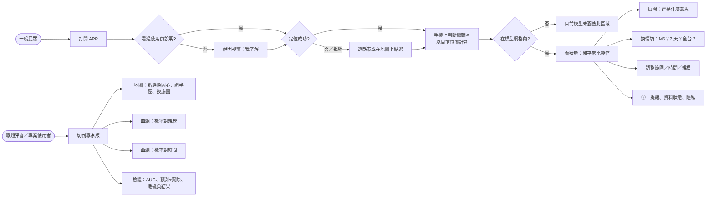
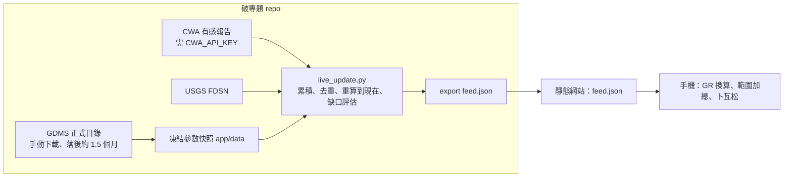

# 設計書（v0.4：Phase 3 進行中）

> 狀態：**Phase 2 已上線（2026-11-17）**：APP 讀破專題每 15 分鐘發布的 `feed.json`（v1.1 模型），執行時驗證、離線退回上次資料、超過 1 小時標示過期；「更多 → 最近的地震」由手機直接讀 ExpTech 地震報告（只顯示、不進入風險計算）。每 15 分鐘的更新由外部定時服務觸發（GitHub 內建排程實測不可靠，見 §10）。
> **Phase 3 進行中（2026-11-18 起，§11）**：餘震卡已完成；全台排行榜＋條件掃描器、地震列表加強接著做。
>
> 開發順序：1 PWA／免責／定位／地圖 → 2 真資料＋更新流程＋Py/TS 一致 → **3 餘震、排行榜、掃描器、地震列表（本版）** → 4 滑桿、收藏、分享 → 5 `?q=` 串接、歷史頁。

## 1. 目標與定位

把破專題的「連續式風險函數」做成一般人看得懂的手機網頁 APP（PWA）。

- **大眾版**：打開就看到「我附近現在和平常比怎樣」，一個狀態、一個數字，不需要懂模型。
- **專家版**：「規模、時間、地點三選二」的三種檢視、回測驗證、原理與資料下載。

**為什麼用倍數決定顏色、而不是絕對機率**：M5 以上 3 天內的機率在台灣幾乎永遠是「個位數 %」，
單看絕對值無法判斷高低，也容易讓人以為「很低＝安全」。倍數（現在÷平常）才是模型帶來的資訊；
絕對機率仍放在下方，兩者都看。

## 2. 頁面清單

| 路由 | 頁面 | 內容 |
|---|---|---|
| （啟動時） | 使用前說明 | 第一次開啟的視窗：不是預報、不代表安全、以氣象署為準、資料延遲、僅供參考、位置不外送。「我了解」＋「不再顯示」 |
| `#/` | 大眾首頁 | 位置（鄉鎮區＋定位誤差）、條件、一個狀態（倍數＋顏色）、現在／平常機率、「已驗證／外推估計」標籤、最近的較大地震（餘震卡，有符合的地震才出現，§11）、三個摺疊區、安裝提示 |
| `#/info` | ⓘ 說明與資料狀態 | 目前條件的提醒、使用前說明、資料狀態、位置與隱私、安裝與更新、CARTO 金鑰、資料來源與授權 |
| 面板 | 選位置 | 使用目前位置、在地圖上點選、20 縣市 |
| 面板 | 調整條件 | 範圍、時間、規模 |
| `#/expert/map` | 風險地圖 | 每格機率／和平常比；點地圖換圓心、半徑滑桿、全螢幕、底圖切換、平滑 |
| 面板 | 地圖設定 | 平滑程度、底圖（全螢幕時另含規模與時間） |
| `#/expert/mag` | 換規模 | 地點＋時間 → 機率對規模；反查 50%／10%／1% 對應規模 |
| `#/expert/time` | 換時間 | 地點＋規模 → 機率對時間（1 小時～30 天） |
| `#/expert/verify` | 驗證與原理 | AUC 與預測÷實際矩陣、公式、地磁負結果、門檻、資料狀態 |
| `#/expert/more` | 更多 | 歷史回放（空殼）、資料下載、最近地震、參考資料 |

**為什麼把提醒移到 ⓘ 頁**：雛型把「可能低估 N%」「回測偏高估」等黃色警示直接放在首頁，試用後發現提醒一多，
最重要的那句（不是預報）反而沒人看。現在首頁只留一個不顯眼的標籤（已驗證範圍／外推估計）和「資料說明（N 則提醒）」連結，
細節集中在 ⓘ 頁。假資料階段的黃色提示條仍然保留——數字是假的這件事不能藏。

## 3. 使用案例

## 4. 資料流程（接真資料後；Phase 2 會再確認架構）

- 後端只給「每格 × 10 個時間長度的 M≥3.5 期望數」（完整模型與平常各一份）、b、m_ref、資料狀態、近期地震、回測表。格式見 `src/data/schema.ts`。
- 手機端做：log–log 時間內插、古騰堡–芮克特換算、點範圍面積比例（10×10 子點）、卜瓦松。對應 `app/hazard_core.py`。
- **驗證層**：Phase 2 加對照測試——同一組輸入，TS 與 Python 結果相對誤差 < 1e-9。
- **位置隱私**：定位只在手機端算；存到 localStorage 前降低精度（GPS 0.01°、地圖選點 0.001°）；從不送出。

## 5. 狀態門檻（暫定）

| 倍數 | 標題 | 顏色 |
|---|---|---|
| < 1.5 | 和平常差不多 | 灰 |
| 1.5–3 | 比平常高一些 | 黃 |
| 3–10 | 比平常高不少 | 橘 |
| ≥ 10 | 遠高於平常 | 紅 |

- 刻意**不用綠色、不說「安全」「無需注意」**：台灣本來就常有地震。
- 位置在模型網格外（或圓形範圍有一半以上在外面）時**不顯示狀態**，改顯示「目前模型未涵蓋此區域」，並註明「這不代表這裡沒有地震風險」。
  雛型在這種情況會算出平常機率 0、倍數無限大，顯示成「遠高於平常」——是錯的，本版已修正（`assessPoint` 的 `covered`）。
- **待辦**：用回測期間每個發布時間、預設條件（50 km、3 天、M5）統計各狀態出現頻率再定，目標是「高不少」以上不要天天出現。

## 6. PWA：可安裝與離線

**為什麼自己寫 service worker，不用現成套件**：現成的 PWA 套件會帶進 Workbox 與 Babel 一長串相依（C 槽空間有限）；
我們需要的只有「把輸出檔清單與版本雜湊填進樣板」，寫在 `vite.config.ts` 的 `swPlugin` 約三十行，也比較看得懂。

| 項目 | 做法 | 原因 |
|---|---|---|
| 圖示 | 192／512 PNG（any 與 maskable 各一組）、180 的 apple-touch-icon；`scripts/make_icons.py` 產生 | Chrome 的安裝條件要 PNG；iPhone 不吃 SVG；maskable 會被裁切所以內容要縮在安全區 |
| 頁面（index.html） | 先走網路，逾時 4 秒或離線才用快取 | 有網路時一定拿到最新版，不會卡在舊版 |
| 自己的靜態檔 | 先用快取（檔名帶雜湊） | 開啟快、可離線 |
| 地圖圖磚 | **完全不攔截、不另外存** | OSM 禁止預抓與離線；CARTO 禁止存超過 30 天 |
| 新版 | 裝好後等待，全部關掉再開才換；ⓘ 頁可「檢查更新／套用新版」 | 不打斷正在看的畫面，又能手動確認手機上是最新版 |
| 建置檢查 | `scripts/check-dist.mjs`（`npm run build` 的最後一步） | 圖示尺寸不符、預存清單有不存在的檔案，都只會在使用者手機上默默失敗 |

**已驗證**（2026-11-16，Chromium，正式建置）：manifest 解析無錯誤；service worker 接手頁面；
`Page.getInstallabilityErrors` 除了測試環境的無痕視窗外沒有其他項目；斷網後重新載入可開啟，鄉鎮區界線檔讀得到。
**實機**：Android 已由使用者確認可開啟、可安裝（2026-11-17）；iPhone 尚未驗證。

## 7. 鄉鎮區本機判斷

**為什麼不查 API**：國土測繪中心有「坐標回傳行政區」的開放 API，但那等於把使用者的位置送出去。
改成把界線檔簡化後內建在 APP，全部在手機上算。

- **資料**：內政部國土測繪中心「鄉鎮市區界線(TWD97經緯度)」1140318 版（政府資料開放授權條款－第1版）。原始檔 18 MB。
- **簡化**（`scripts/build-towns.mjs`）：mapshaper，Douglas–Peucker `interval=50`（公尺）＋ TopoJSON 量化 → `src/data/towns.topo.json` 298 KB（傳輸約 88 KB）、368 個鄉鎮市區。
  選 Douglas–Peucker 是因為它**保證**簡化後的線和原本的線相差不超過指定距離；加上量化誤差，上限是 **61 公尺**（寫在檔案的 `meta.tolerance_m`）。
- **判斷規則**（`src/geo/towns.ts`）：把「定位誤差＋61 公尺」當成不確定半徑。

| 情況 | 顯示 |
|---|---|
| 在某區內，半徑內沒有別的鄉鎮區 | 高雄市三民區 ＋ 定位誤差約 30 公尺 |
| 在某區內，半徑內還有別的鄉鎮區 | 高雄市三民區**附近** ＋ 定位誤差約 850 公尺 |
| 不在任何區內（海上），20 公里內有鄉鎮區 | 花蓮縣花蓮市**附近** ＋ 離岸約 3.2 公里 |
| 更遠 | 座標（23.90°N, 122.20°E） |

- **驗證層**（`src/geo/towns.test.ts`）：沿原始界線每 8 公里取一點、隨機偏移 0–200 公尺，再加 300 個隨機點，共 1,365 點；
  用 mapshaper 對**原始**界線判斷當標準答案（和 APP 的程式互相獨立）。結果：APP 說「有把握」的 391 點**全部正確**。
- **已知限制**：
  - 比誤差上限還小的島礁會被簡化掉（1,073 個陸地對照點中有 2 個：澎湖西嶼鄉的小島、恆春外海的七星岩），那裡會顯示成最近鄉鎮區的「附近」。
  - 屏東縣瑪家鄉三和村是飛地，內政部版界線檔把它另外放在補充檔；本 APP 只用主檔，那裡會顯示成周圍的鄉鎮。
  - 界線是 2025 年 3 月的版本，之後的行政區調整要重跑腳本。

## 8. 地圖

- **點地圖換圓心**：圓心就是首頁用的「位置」。點到地震圓點只看它的資訊，不換圓心。
- **半徑滑桿**：5–200 km。拖的時候只更新圓與數字，放開才存。小於一格（約 22 km）時是把那一格的機率依面積比例分配，ⓘ 頁會提醒。
- **全螢幕**：用 CSS 把地圖區塊蓋滿畫面，不用瀏覽器的 Fullscreen API（iPhone 不支援）。
- **地圖不跟著整頁重畫**：APP 每次狀態改變都整頁重畫，但 Leaflet 的容器由 `ui/map.ts` 自己留著，所以換條件不會跳回原位、也不會重抓圖磚。
- **平滑化（只是顯示效果）**：把 0.2° 格子的值在對數空間做雙線性內插（可再加高斯模糊），畫成一張影像貼上去。
  **沒有重算 0.1°、沒有重做回測**；模型解析度仍是 0.2°。所以：平滑開啟時畫面有註明；點選顯示的數字一律取原始格子；
  影像的列依麥卡托投影排列（用緯度等分的話中段會偏約 2.6 公里）。

### 底圖與授權（2026-11-15 查證）

| 底圖 | 金鑰 | 條款重點 | 來源標示 |
|---|---|---|---|
| OpenStreetMap（淡化、深色） | 否 | 須清楚標示；禁止預抓與離線；要送 Referer | © OpenStreetMap contributors |
| OpenTopoMap | 否 | CC-BY-SA；不保證可用性；勿大量下載 | 地圖資料 © OpenStreetMap contributors、SRTM｜地圖樣式 © OpenTopoMap（CC-BY-SA） |
| 國土測繪中心 通用電子地圖（EMAP）、正射影像（PHOTO2） | 否 | 官方「免申請服務介接說明表」（113/1/3）列為免申請、對象不限。**沒查到流量上限與標示格式的明文**，採保守做法 | 圖資來源：內政部國土測繪中心 |
| CARTO Voyager／Positron／Dark Matter | **是** | 2026-09-25 起必須帶金鑰；金鑰放在圖磚網址；可設網域限制；**禁止伺服器端代理或快取**；裝置端快取不得超過 30 天；非商業每月 500 萬張 | © OpenStreetMap contributors, © CARTO |

**CARTO 金鑰怎麼放**：金鑰本來就會出現在瀏覽器的圖磚網址裡（CARTO 的設計，靠後台的網域限制保護），
而且條款禁止用自己的伺服器代理，所以「完全藏起來」做不到。目前的做法是**使用者在 ⓘ 頁貼上自己的金鑰，只存在那支手機**——
repo 與網站都不含金鑰。程式也支援建置時的 `VITE_CARTO_KEY`（會打包進公開網站），要不要啟用由專案擁有者決定；
啟用的話務必在 CARTO 後台把金鑰限制在 `azazelowo.github.io`。

## 9. 風險與對策

| 風險 | 對策 |
|---|---|
| 一般人把機率當預報 | 第一次開啟的說明視窗；每頁頁尾「不是地震預報」；措辭避免確定語氣 |
| 「和平常差不多」被讀成安全 | 副標題「台灣本來就常有地震，防震準備照常」；不用綠色 |
| 網格外的位置被算成高風險或零風險 | `covered` 判斷，顯示「目前模型未涵蓋此區域」 |
| 鄉鎮區講錯 | 誤差上限＋「附近」；對照原始界線的測試 |
| 平滑後的圖被當成更高解析度 | 畫面註明；數字取原始格子 |
| 手機卡在舊版 | 頁面先走網路；ⓘ 頁顯示版本與「檢查更新」 |
| 底圖服務改政策或掛掉 | 五種免金鑰底圖可切換；載入失敗時地圖上有提示；沒網路時格子仍顯示 |
| 金鑰外洩 | 金鑰只存使用者裝置；`.env*` 不進 git；建置檢查發現內建金鑰時會提醒 |
| TS 與 Python 算法分歧 | 對照測試（Phase 2） |
| GitHub 內建排程延遲或停擺，資料沒更新 | 外部定時服務每 15 分鐘觸發（§10）；APP 超過 1 小時標示過期 |
| 餘震卡在大地震剛發生時偏低（v1.1 模型 alpha＝0） | 卡片上直接寫「可能偏低」與原因，不藏到 ⓘ 頁；模型修正排在 12/9 之後（§11） |

## 10. 之後的步驟

1. **Phase 2（已實作）**：架構（2026-11-17 使用者確認）——
   - **風險數值**：破專題 `app/live_update.py`＋`app/export_feed.py`，`.github/workflows/hourly-feed.yml` 每 15 分鐘用氣象署開放資料（`CWA_API_KEY` Secret）＋USGS 重算、推到 feed 分支。金鑰只在 Actions，不進前端。不用 ExpTech 算風險：條款要求使用者直連、不得經自己的伺服器轉發，TREM 也不得用於預測。
   - **地震列表**：手機直接呼叫 ExpTech `/api/v2/eq/report`（免 Token、CORS 開放，三台主機依序備援），標示「資料來源：中央氣象署、ExpTech Studio（exptech.dev）」；連不上就用 feed 裡的地震。請求不帶位置。
   - **USGS**：只當 Actions 的補充來源（M4 以上），不直接給手機。
   - APP `src/data/feed.ts`（驗證、快取、退回、過期標示）、`src/data/exptech.ts`、畫面出錯時顯示錯誤卡片而非空白（審查 H3）。
   - **TS／Python 一致性**：`src/core/parity.test.ts` 讀破專題 `app/export_parity.py` 產生的對照資料，相對誤差 < 1e-9。
   - **上線**（2026-11-17）：破專題 PR #23 合併、`CWA_API_KEY` Secret 已設、第一次手動執行成功，APP 讀到真資料。
   - **定時觸發（2026-11-18 改）**：GitHub 內建排程實測不可靠——上線後數小時一次都沒有自動執行，同 repo 其他排程也晚 3～9 小時。
     改由使用者在 cron-job.org 設定每 15 分鐘呼叫 GitHub 的 `workflow_dispatch` API（`hourly-feed.yml`、ref `main`）。
     權杖是使用者自建的 fine-grained token：只限破專題 repo、只有 Actions 讀寫，不在任何 repo 裡。
     工作流程內的 cron 保留當備援；兩邊同時觸發會依序執行（`concurrency`），結果相同、不會衝突。
     - **會讓更新停掉的事**：權杖到期（到時重建並換到 cron-job.org）；工作流程改檔名或拿掉 `workflow_dispatch`；cron-job.org 停用這個工作。發生時 APP 會在 1 小時後顯示「資料已過期」。
   - **尚未做**：iPhone 實機測試。
2. **Phase 3（進行中，§11）**：餘震機率預估、首頁「目前全台風險排行榜」、條件掃描器（依倍數排序、只收 p≥1%）、地震列表。
3. 用回測統計定狀態門檻。
4. 「我也會地震預測」加 `?q=`（仍經輸入把關與確認卡，不自動送出）。
5. 有空就做：收藏地點、歷史回放、斷層圖層、震度。

## 11. Phase 3（2026-11-18 起）

**範圍與順序（2026-11-18 使用者確認「全部照建議」）**：餘震卡 → 全台排行榜＋條件掃描器 → 地震列表加強；一項一項上線，12/6 起凍結程式、只修錯誤（破專題審查報告 §4.6 的建議）。排行用縣市為單位；餘震用現有模型；不開多代理。

**和規劃文件的落差（使用者已決定）**：破專題審查報告 §4.6 原本寫「Phase 3 只做全台排行」；SA&D 08 專案管理因資源過載 25% 建議全台排行延到 12/9 後。Phase 2 比計畫提早上線（原排 11/22–11/30，實際 11/17），所以三項都做。

**先知道：沒有大地震時畫面很平淡**。2026-11-18 08:30 的真資料試算：20 縣市 × 各種規模與時間，倍數全部在 0.39–1.18；模型資料近 7 天沒有 M5 以上。這是誠實的結果。倍數低於 1 是正常的：「平常」是包含過去大地震餘震期的長期平均，平靜時「現在」會比它低（畫面上 1.15 倍以下一律寫「約 1 倍」）。上台展示另備錄影、截圖。

### 11.1 餘震卡（首頁，已完成）

| 項目 | 做法 |
|---|---|
| 挑哪個地震 | `feed.recent` 裡，資料發布前 7 天內 M5 以上、或 30 天內 M6 以上的地震中規模最大的（同規模取較近的）；沒有就整張不出現（`src/core/aftershock.ts`） |
| 數字 | 震央周圍 50 km，M4／M5 以上 × 1／7／30 天的「現在」與「平常」。用 `assessCircle`——和首頁的 `assessPoint` 完全相同，只是面積比例先算好一次。**沒有新的數學**，TS／Python 一致性測試已涵蓋 |
| 震央位置文字 | 在鄉鎮區內講名字；在外面講「離 XX 約 N 公里」；80 km 內沒有鄉鎮區就給座標（`epicenterText`）。不說「海上」：網格西北角有中國大陸沿岸。界線檔在手機上判斷，不送出位置；還沒載入時先給座標 |
| 模型範圍外 | 震央周圍大半在網格外：不給數字，並寫「這不代表那裡不會有餘震」 |

**為什麼沒有另外做餘震模型**：Reasenberg–Jones（1989）這類專門的餘震公式，參數要有可查證的出處（原文是加州的通用參數），而且要在破專題 `hazard_core.py` 和 APP 兩邊實作、加進對照測試，畫面上還會同時出現兩套模型的數字。12/9 前先用現有模型，把限制寫清楚。

**限制（直接寫在卡片上，不藏到 ⓘ 頁）**：
- v1.1 模型 alpha＝0（擬合結果卡在搜尋範圍下限）：規模不影響近期加成，大地震和小地震被當成會帶來一樣多的餘震，**大地震剛發生時偏低**，要等餘震陸續進到資料裡才追上。修正排在 12/9 之後（破專題 `docs/reports/hazard_v1/README.md` 已知限制 3）。
- 模型不分主震、餘震：算的是震央附近「再發生地震」的機率，包含平常就會有的地震。
- 外海定位差的地震不在模型裡；新地震要等下一次資料更新（每 15 分鐘）才算進去。

**驗證**：`src/core/aftershock.test.ts`（挑選規則與邊界、和 `assessPoint` 相同、範圍外標成未涵蓋）、`src/ui/public.test.ts`（措辭、範圍外不出現百分比）、`src/geo/towns.test.ts`（震央文字）。375px 用假資料（花蓮外海 M5.8）看過深色與淺色。

**順手修正**：整頁重畫時，摺疊區的展開狀態原本用「第幾個」對應；餘震卡會依資料出現或消失，順序一變就會展開錯的區塊。改成用 `data-fold` 或標題文字對應（`main.ts` 的 `foldKey`）。
